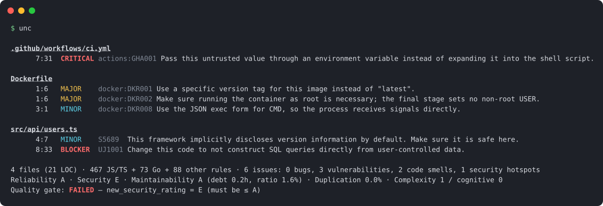

<div align="center">

# uncomplicated

**SonarQube-grade static analysis in one fast binary.**

JavaScript · TypeScript · Go · Dockerfile · Kubernetes · GitHub Actions · Terraform · CSS · secrets · dependencies

[](https://github.com/gokaykucuk/uncomplicated/actions/workflows/ci.yml)
[](https://github.com/gokaykucuk/uncomplicated/releases)
[](LICENSE)

[Quick start](#quick-start) · [What it checks](#what-it-checks) · [CI](#use-it-in-ci) · [Configuration](#configuration) · [Performance](#performance) · [Docs](#documentation)



</div>

`unc` runs SonarQube's rules, metrics and quality gate on your code, plus checks for your
infrastructure, secrets and dependencies. It runs as a single native binary: there's no server,
JVM or Node.js to install, and a 1.6M-line monorepo is analyzed in about a second.

## Why unc

- **Fast enough for every push.** Rust, native parsers, one pass per file, all cores, and a
  content-hash cache. A monorepo whose SonarQube scan took 633 s takes about a second.
- **SonarQube-compatible.** It uses the same rule keys, messages, ratings and "Sonar way" quality
  gate, and reads your existing `sonar-project.properties`. On SonarJS's own test corpus it reaches
  99.9% precision and 97.5% recall against SonarJS.
- **More than source code.** One run also covers Dockerfiles, Kubernetes manifests, workflows,
  Terraform, stylesheets, hard-coded secrets and vulnerable dependencies.
- **Built for pull requests.** It gates only the lines a branch changes. Results come out as
  GitHub annotations, SARIF, GitLab Code Quality, or SonarQube's import format.
- **Precise by design.** When `unc` can't be sure, it stays silent. A finding should be worth
  reading.
- **Private.** Analysis runs locally and never uses the network.

## Quick start

**Install** a prebuilt static binary (Linux x86_64/arm64, macOS arm64):

```bash
# macOS (Apple silicon)
curl -fsSL https://github.com/gokaykucuk/uncomplicated/releases/latest/download/unc-aarch64-apple-darwin.tar.gz | tar -xz -C /usr/local/bin

# Linux x86_64 (use unc-aarch64-unknown-linux-musl.tar.gz on arm64)
curl -fsSL https://github.com/gokaykucuk/uncomplicated/releases/latest/download/unc-x86_64-unknown-linux-musl.tar.gz | tar -xz -C /usr/local/bin
```

or run the container, or build from source with Rust:

```bash
docker run --rm -v "$PWD:/src" ghcr.io/gokaykucuk/uncomplicated:latest
cargo install --git https://github.com/gokaykucuk/uncomplicated uc-cli
```

**Run** it in a repository:

```bash
unc                                   # analyze the current directory
unc --new-code origin/main            # gate only what this branch changed
unc --coverage coverage/lcov.info     # add coverage (LCOV, Go, Cobertura, Clover, Istanbul...)
```

The exit status is `0` when the quality gate passes and `1` when it fails, so `unc` can be a
CI step as is.

## What it checks

| Area | Rules | What you get |
|---|---:|---|
| **JavaScript / TypeScript** | 567 | All of SonarJS but one rule, including React, Vue, Angular, Node.js, tests and accessibility. Taint analysis follows request data to SQL, shell, file, HTML, redirect, fetch and Mongo sinks. Module-graph checks: broken imports, missing exports, import cycles. |
| **Go** | 102 | All of sonar-go, plus checks modeled on go vet, staticcheck, errcheck, ineffassign and gosec. Package-wide checks: unused declarations, ignored errors, copied locks. Taint analysis for net/http, gin, echo, chi and fiber handlers. |
| **Secrets** | 21 | AWS, GitHub, GitLab, Slack, Stripe, Google, OpenAI, Anthropic, npm and more; private keys; passwords in connection URLs; secrets in `.env` and config files. |
| **Dockerfile** | 15 | Unpinned images, running as root, `curl \| sh`, secrets in `ENV`/`ARG`, package-manager hygiene. |
| **Kubernetes** | 11 | Privileged pods, host namespaces and paths, dangerous capabilities, missing limits, literal secrets. |
| **GitHub Actions** | 8 | Script injection, unsafe `pull_request_target` checkouts, over-broad permissions, deprecated commands. |
| **Terraform** | 12 | Public buckets, open security groups, missing encryption, hard-coded credentials, wildcard IAM, weak TLS. |
| **CSS · SCSS · Less** | 24 | Unknown properties, units and selectors, invalid colors and `calc()`, duplicate and overridden declarations. |
| **Dependencies** | 4 | Vulnerable and malicious versions in npm, Yarn, pnpm and Go lockfiles, from an offline OSV database. Opt-in with `unc deps update` and `--deps`. |

Every rule is listed in [docs/RULES.md](docs/RULES.md). `unc rules` prints them in your terminal.

On top of issues, `unc` computes the measures teams track:

- **Size and complexity:** lines of code, cyclomatic and cognitive complexity.
- **Debt and ratings:** technical debt and A–E reliability, security and maintainability ratings.
- **Duplication:** token-based, across files.
- **Coverage:** from LCOV, Go, Cobertura, Clover, Istanbul and SonarQube generic reports.

The quality gate evaluates these measures, by default only on new code.

## Use it in CI

<details open>
<summary><b>GitHub Actions</b></summary>

```yaml
jobs:
  quality:
    runs-on: ubuntu-latest
    steps:
      - uses: actions/checkout@v7
        with:
          fetch-depth: 0 # new-code detection needs the merge base
      - uses: gokaykucuk/uncomplicated@v0.1.1
        with:
          args: --format github --new-code origin/${{ github.base_ref || 'main' }}
```

Findings appear as annotations on the pull request, and the action caches results between runs.
For GitHub code scanning, add `--report sarif=unc.sarif` and upload the file with
`github/codeql-action/upload-sarif`.

</details>

<details>
<summary><b>GitLab CI</b></summary>

```yaml
code_quality:
  image:
    name: ghcr.io/gokaykucuk/uncomplicated:latest
    entrypoint: [""]
  variables:
    GIT_DEPTH: 0
  script: unc --new-code origin/$CI_MERGE_REQUEST_TARGET_BRANCH_NAME --report gitlab=gl-code-quality.json
  cache:
    key: unc
    paths: [.uncomplicated/]
  artifacts:
    reports:
      codequality: gl-code-quality.json
```

</details>

<details>
<summary><b>Anything else</b></summary>

Run the binary or the container, and cache `.uncomplicated/` between runs so unchanged files are
skipped. Use `--format` / `--report` to pick an output:

| Format | For |
|---|---|
| `text`, `summary` | humans |
| `json` | scripts and dashboards (issues, measures, gate, duplications) |
| `sarif` | GitHub code scanning and other SARIF 2.1.0 consumers |
| `gitlab` | GitLab Code Quality |
| `github` | GitHub workflow annotations |
| `sonar` | importing results into a SonarQube server |

</details>

## Configuration

None is needed. If the project has a `sonar-project.properties`, `unc` uses its sources,
exclusions, coverage paths and issue exclusions. To match a specific SonarQube server exactly,
pin its rule set with `--profile sonarqube-26.9`.

For anything else, add an `uncomplicated.toml` (`unc init` writes a starter file):

```toml
[analysis]
exclusions = ["generated/**"]

[new_code]
reference = "origin/main"

[coverage]
reports = ["coverage/lcov.info", "coverage.out"]

[rules]
S3776 = { threshold = 20 }   # tune a parameter
S1135 = "off"                # turn a rule off
"docker:DKR001" = "off"      # rules of other repositories have a prefix
```

To silence findings:

- one line: `// NOSONAR` or an `eslint-disable` comment;
- a rule in some paths: an `[[ignore]]` entry;
- a legacy codebase: record what exists today with `unc --write-baseline`, and later runs only
  report new issues.

Everything is in the [configuration reference](docs/CONFIGURATION.md).

## Performance

Cold cache, default rules:

| Codebase | Files | Lines of code | Time | Memory |
|---|---:|---:|---:|---:|
| SonarJS ruling corpus (JS/TS, 53 projects) | 20,417 | 2.35M | 1.4–1.7 s | 0.9 GB |
| Kubernetes (Go) | 9,724 | 2.23M | 3.2 s | 0.55 GB |
| Prometheus (Go) | 998 | 345k | 0.5 s | 0.2 GB |

These numbers come from a 12-core laptop. A warm cache with nothing changed brings the JS/TS
corpus down to 0.4 s. Every pull request that touches the analyzers runs the
[`bench` workflow](.github/workflows/bench.yml). It compares the change with its base on
Kubernetes, Prometheus, Grafana, Discourse and Excalidraw, and reports time, memory and issue
counts per rule.

How it stays fast:

- **Native parsers:** [oxc](https://oxc.rs) for JS/TS, tree-sitter for Go, YAML and HCL,
  hand-written parsers for Dockerfiles and CSS.
- **One pass per file:** rules subscribe to the syntax nodes they need, and a single walk
  dispatches to all of them.
- **Cheap prefilters:** secret detection is one Aho-Corasick pass, and taint analysis skips files
  with no possible source.
- **Parallel and cached:** all cores, content-hash caching, and cross-file checks that run from
  cached summaries instead of reparsing.

## FAQ

<details>
<summary><b>Does it replace SonarQube?</b></summary>

For many teams it does: the rules, ratings and gate are the same, and they run in CI without a
server. If you want SonarQube's dashboards and history, keep the server and use `unc` for fast
feedback on pull requests. `--report sonar=unc.json` produces SonarQube's generic issue format
for import.

</details>

<details>
<summary><b>How accurate is it compared with SonarQube?</b></summary>

`tools/parity.py` compares `unc` with SonarJS's own expected results on its ruling corpus:

- 471 rules compared;
- 99.9% precision and 97.5% recall;
- 352 rules match exactly.

Most of the gap comes from rules that need the full TypeScript type checker, where `unc` stays
silent rather than guess.

</details>

<details>
<summary><b>Does my code leave the machine?</b></summary>

No. The only network access is `unc deps update`, which downloads public advisories from OSV.
Analysis itself runs offline.

</details>

<details>
<summary><b>Can I add my own rules?</b></summary>

Yes. Rules are plain Rust files that are discovered automatically. See the guides for
[JS/TS](docs/RULE_AUTHORING.md) and [Go](docs/GO_RULE_AUTHORING.md).

</details>

## Documentation

| | |
|---|---|
| [Configuration](docs/CONFIGURATION.md) | Every option, coverage formats, baselines, quality gate |
| [Rules](docs/RULES.md) | All rules, by language and area |
| [Architecture](docs/ARCHITECTURE.md) | How an analysis runs, crate by crate |
| [Writing rules](docs/RULE_AUTHORING.md) | JS/TS rule guide ([Go](docs/GO_RULE_AUTHORING.md)) |
| [Contributing](CONTRIBUTING.md) | Building, testing, benchmarking |

## Contributing

Bug reports, false positives and new rules are welcome. Please open an issue with a minimal
example. To build and test:

```bash
cargo build --release && cargo test --workspace
```

The [contributing guide](CONTRIBUTING.md) covers the ground rules: precision first, measure
speed, keep SonarQube compatibility.

## Acknowledgements

Rule keys, messages and metrics follow [SonarSource](https://www.sonarsource.com/)'s SonarJS and
sonar-go analyzers. `uncomplicated` is an independent project, not affiliated with SonarSource.
It builds on [oxc](https://oxc.rs), [tree-sitter](https://tree-sitter.github.io/) and the
[OSV](https://osv.dev) vulnerability database.

## License

[MIT](LICENSE)
